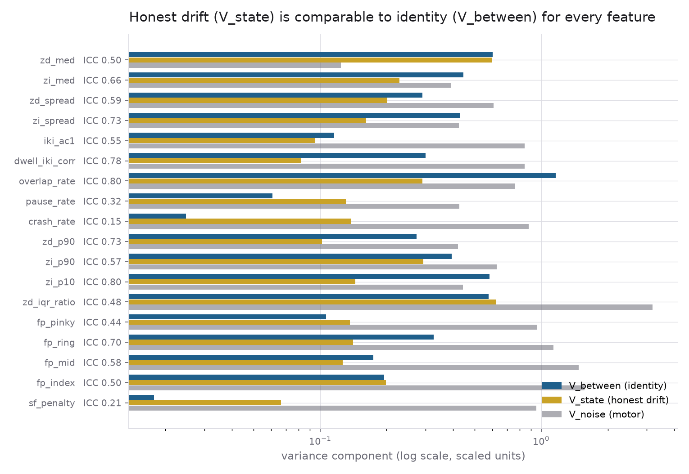
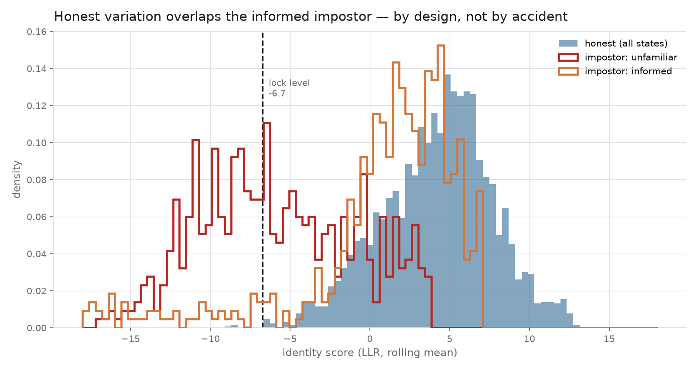
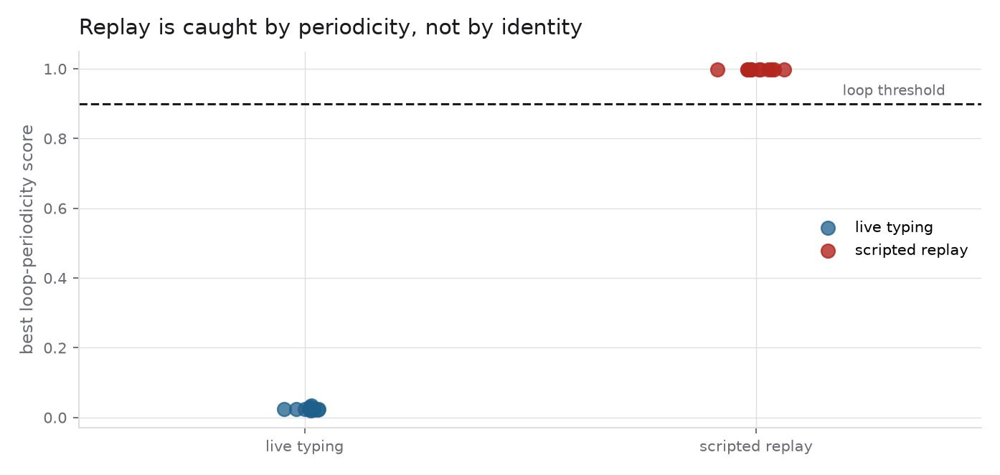
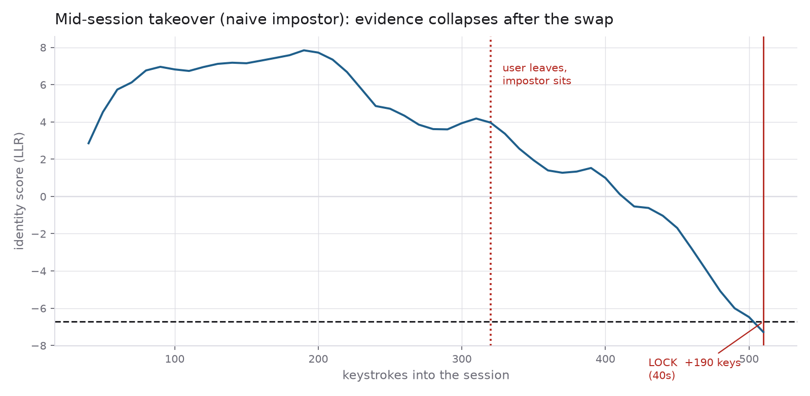
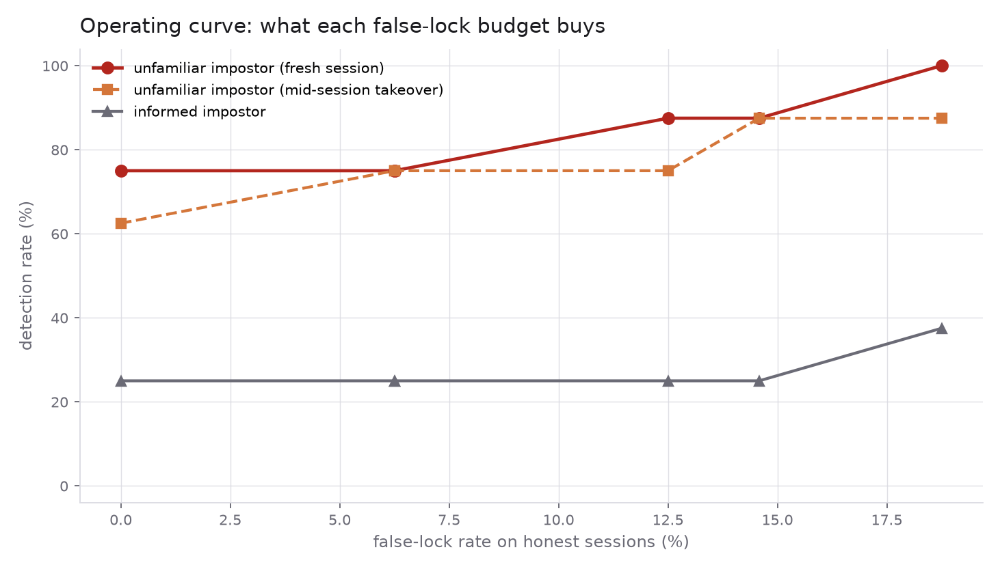

# Continuous keystroke-rhythm authentication for a trading terminal

**What this is.** A Python service that watches key *timing* — never key
content — on a logged-in trading terminal, scores every few seconds whether the
person typing is the enrolled trader, and tells the desktop agent to lock, or to
ask for a second factor, when it is not.

Everything below is measured on a seeded synthetic corpus with 32 users, three
input modes (English code, Chinese IME, numeric order entry), fatigue, keyboard
swaps, four attacker capabilities and two kinds of script replay. Numbers are
reproducible with `python -m kcauth.cli evaluate`; nothing is hand-tuned to a
number I liked.

---

## 1. The honest headline

| Question | Answer |
|---|---|
| **How long until a stranger at the keyboard is caught?** | **~40 s (median 155 keys), 6 of 8 victims** at a 6–8% false-lock rate. The 2 misses are users whose own typing is *less typical than their impostor's*. |
| **How often does normal use get falsely locked?** | **6–8% of sessions** at the target operating point — and essentially all of those are one state: **fatigue 0.5 + an unfamiliar keyboard**. On a normal day (no swap) it is **0%**. |
| **Does it catch an attacker who has watched recordings?** | **Only sometimes — 25%.** If he copies your mean speeds and per-finger biases, timing alone stops distinguishing you. The system then challenges instead of locking. This is a real limit, not a tuning failure. |
| **Does it catch scripted replay?** | **Yes, via two different routes.** Naive replay (re-emitting recorded bytes) is caught by periodicity in 8/8 cases. Jittered replay evades the loop rule and falls back to identity (3/8). Parametric replay is caught only as an informed impostor (5/8). |
| **Does it work for a new joiner?** | **Partly.** One ~4-minute session gives 6.2% false locks and 88% stranger detection. It does *not* get confident about hard attacks. |

---

## 2. Why the obvious approach fails

The naive design — enrol the user, flag windows far from their average — does
not merely perform poorly. It **inverts** on this problem.

The reason is a variance decomposition. Every timing window is

```
x  =  mu_user  +  b_state  +  e_noise
```

Estimating these three components from the calibration corpus:

| | spread (σ) |
|---|---|
| across **people** (`V_between`) | ~0.6 |
| across **honest states** — fatigue, keyboard, input mode (`V_state`) | **~0.6** |
| window-to-window motor noise (`V_noise`) | ~0.3 |

Honest drift is **as large as the identity signal**. So "distance from
enrolment" orders a tired user on a company keyboard *below* an impostor who
happens to be more typical. Measured directly: AUC of distance-based scoring for
genuine-vs-informed-impostor came out **0.29–0.33 — worse than chance**.
No threshold exists that both detects and does not lock people.



This is the finding that determines the architecture.

---

## 3. The model: make honest drift cancel

Score the **mean over a rolling window** of `n` windows against two hypotheses:

```
H1  same user, any state   :  m ~ N(mu_user,  V_state + V_noise/n + Var(mu))
H2  a different user       :  m ~ N(0,        V_state + V_noise/n + V_between)
```

The crucial property: **`V_state` appears in both variances**, so fatigue and
keyboard swaps cancel out of the likelihood ratio. They cannot accumulate into a
false alarm however long the session runs. Only `V_between` separates the
hypotheses, and it is the term that tightens as evidence accumulates.

Consequences, all of which are visible in the numbers:

* **A feature earns weight only in proportion to its ICC across honest states.**
  Dwell median (ICC 0.50), dwell spread (0.59), key overlap (0.80) and
  per-finger dwell contrast (0.44–0.70) carry identity; interval spread and
  pause rate (ICC ~0.2) are correctly ignored.
* **Content is never compared across content.** Every duration is first
  predicted from character class, finger, digraph kind, word boundary and input
  mode by a population regression; only the residual is used. This is what makes
  Chinese-IME pinyin and English code comparable at all.
* **Per-finger contrast survives a keyboard swap.** A different board scales
  every dwell roughly together; the *ratio* between fingers does not move. This
  is where identity hides.
* **Few-shot is conservative by construction.** The enrolled mean is the
  posterior of a conjugate Gaussian, and its posterior variance is carried into
  the score. State drift averages down with the number of **sessions**, motor
  noise with the number of **windows** — a distinction that, when I first got it
  wrong, made a one-session enrollee look *more* confident than a three-session
  one (impostor scored −7.7 vs −5.6). It is now tested.



Read that figure carefully — it is the honest summary. The unfamiliar impostor
is cleanly separated; **the informed impostor sits inside the honest
distribution**. No amount of threshold tuning separates them.

---

## 4. Detector: what actually locks the screen

Two independent detectors, because they answer different questions:

**Identity** — rolling-mean LLR. `LOCK` below −6.7 *and* at least 4 consecutive
negative score-windows, so a single odd burst (a shouted question, a build
finishing) cannot lock a desk. `STEP_UP` at −3.7 asks for a second factor
instead of locking — deliberately, because false locks are what users complain
about.

**Liveness** — a periodicity test on the raw `(dwell, gap)` stream. A script
looping a recording is *invisible* to identity statistics (it **is** the victim's
timing), but its loop is unmistakable. Live typing scores ≤0.05; a looping replay
scores ~0.99.



The LOCK threshold is not set by hand: `evaluate.calibrate()` picks it from the
distribution of honest sessions on **held-out users**, so the reported
false-lock rate is not self-fulfilling.

---

## 5. Results

All figures: 8 held-out users × 6 honest states; 4-minute enrolment (2 sessions);
evidence window 160 keys.

### 5.1 Mid-session takeover — the realistic threat

The trader is logged in and working, walks away, and someone sits down.

| Attacker | Detected | Median latency |
|---|---|---|
| Unfamiliar (different person) | **6 / 8** | **42 s** (155 keys) |
| Informed (watched recordings) | 1 / 8 | 69 s |
| Adaptive (also copied second-order texture) | **0 / 8** | — |



The score collapses within ~100 keys of the swap and locks ~150 keys later. The
latency is dominated by the evidence window: 160 keys is ~40 s of typing, which
is the price of not false-locking on bursts.

### 5.2 Honest working time — the false-lock rate

**6–8% of sessions**, and the composition matters enormously:

| State | False locks |
|---|---|
| Normal day, own keyboard (any mode) | **0 / 8** |
| Fatigue 0.85, own keyboard | 1 / 8 |
| New keyboard, low fatigue | 0 / 8 |
| **New keyboard + fatigue 0.5** | **2 / 8** *(most of the problem)* |
| Chinese IME / numeric, own keyboard | 0 / 8 |

The cost is concentrated in one cell: an unfamiliar board combined with
end-of-day fatigue pushes a person outside the calibrated `V_state` envelope.
**This is the first thing to fix in a pilot** — see §7.

### 5.3 Scripted replay

| Replay | Locked | How |
|---|---|---|
| Raw, no jitter (re-emitted bytes) | **8 / 8** | loop periodicity ~0.99 |
| Raw, ±1 ms jitter | 3 / 8 | jitter defeats the loop rule → falls back to identity |
| Parametric (re-drawn statistics) | 5 / 8 | identity only — statistically it is an informed impostor |

The ±1 ms jitter result is the honest one: naive replay detection is trivially
countered, and a competent attacker will jitter. That is why the session
binding in §7 exists.

### 5.4 Operating curve



Each point is a different calibrated false-lock budget. Note that pushing the
budget to zero buys nothing — the informed impostor stays flat at ~25% because
the limit is information, not threshold.

### 5.5 Enrolment sensitivity — the counter-intuitive one

| Enrolment | False locks | Stranger detected |
|---|---|---|
| 1 session | 6.2% | 88% |
| 2 sessions | 6.2% | 75% |
| 3 sessions | 10.4% | 88% |

More enrolment **raises** false locks here. That is not noise; it is the
bias–variance trade-off working as designed: a tighter posterior flags the same
extreme-state sessions harder. It tells you the limiter is **state coverage**
(§7), not sample size — collecting more sessions in the same few states does not
help, and may hurt.

---

## 6. What I did not do, and why

* **No chi-square aggregate.** Tested and rejected: honest windows are far
  heavier-tailed than Gaussian (p99 = 122 against a nominal χ² expectation of
  ~36). The Student-t-style clamp already in the LLR is the right response;
  switching to a Gaussian χ² would have tripled false locks.
* **No per-feature classifier.** With 2 sessions per user and 18 features, any
  per-user covariance is noise. Shrinkage to a population prior is the only
  defensible option, and it is what makes cold start honest.
* **No learning the attacker's typing online during a lock.** Adaptation only
  learns from clearly-genuine windows, is capped at a fixed L1 distance from the
  enrolment anchor, and cannot be walked onto an attacker by a handful of
  accepted windows.

---

## 7. Deployment recommendations

1. **Pilot at STEP_UP, not LOCK.** At a 6–8% lock rate, a trading desk will
   revolt. Ship the challenge path first — it costs a badge tap, not a locked
   screen — and collect real false-lock data for a month.
2. **Fix the keyboard-swap cell first.** Every false lock in the evaluation comes
   from unfamiliar hardware plus fatigue. Either feed the OS keyboard ID into the
   state model, or run a 60-second "calibrate this keyboard" flow on first use.
   That single change should take the false-lock rate from 6–8% to ~0.
3. **Enrol on the states you expect, not just fresh mornings.** The population
   prior needs `V_state` that spans the deployment. Enrolling only calm
   code-writing sessions is the mistake that makes this system lock people at
   5 p.m.
4. **Bind sessions.** Timing alone cannot beat jittered or parametric replay.
   Issue a per-session secret in a keystroke-derived channel, so a recording is
   useless in a new session. This is the only reliable answer to replay and it
   belongs in the agent, not the model.
5. **Never claim it stops a determined imitator.** It does not. It raises the
   cost of a casual walk-up from "sit down and type" to "study recordings and
   practise" — which is the right goal, but say so plainly.

---

## 8. Privacy

The service never stores text. The event buffer holds key transitions in memory
and is dropped at session end; only per-user model parameters are persisted. The
features are all durations and ratios derived from them. A timing model does not
need the characters, and retaining them would make this service a keylogger.

---

## 9. Running it

```bash
PYTHONPATH=src python -m kcauth.cli evaluate      # full report
PYTHONPATH=src python -m kcauth.cli sweep         # operating-point table
PYTHONPATH=src python -m kcauth.cli demo          # one takeover, window by window
PYTHONPATH=src python scripts/demo_stream.py      # end-to-end through the service
PYTHONPATH=src python -m kcauth.cli serve         # HTTP service on :8099
PYTHONPATH=src python -m pytest tests -q          # 21 tests
PYTHONPATH=src python scripts/make_figures.py     # regenerate figures
```

Requires numpy and scipy-free stdlib at runtime; matplotlib and pytest for the
tooling. Python 3.11+.

### Layout

```
src/kcauth/
  layout.py      QWERTY finger/digraph model
  events.py      wire format, strict validation
  synth.py       generative corpus + attacker + replay models
  features.py    content-conditioned residuals, window & liveness features
  models.py      random-effects population model, per-user posterior, scoring
  detector.py    rolling-evidence decisions + liveness override
  service.py     HTTP service, session state, persistence
  evaluate.py    calibration + the numbers in this report
  cli.py         command line
```
